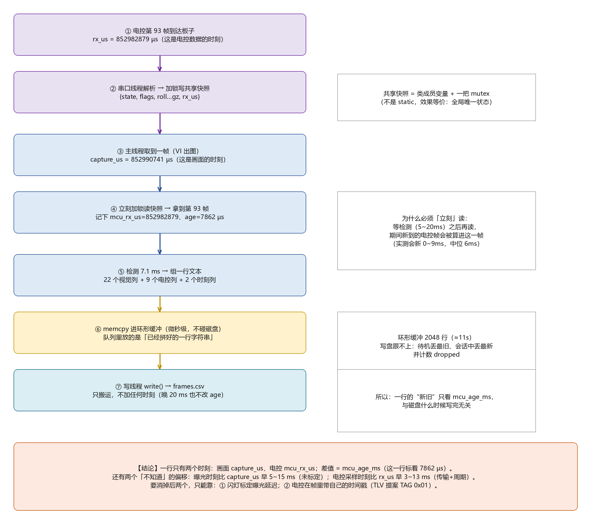
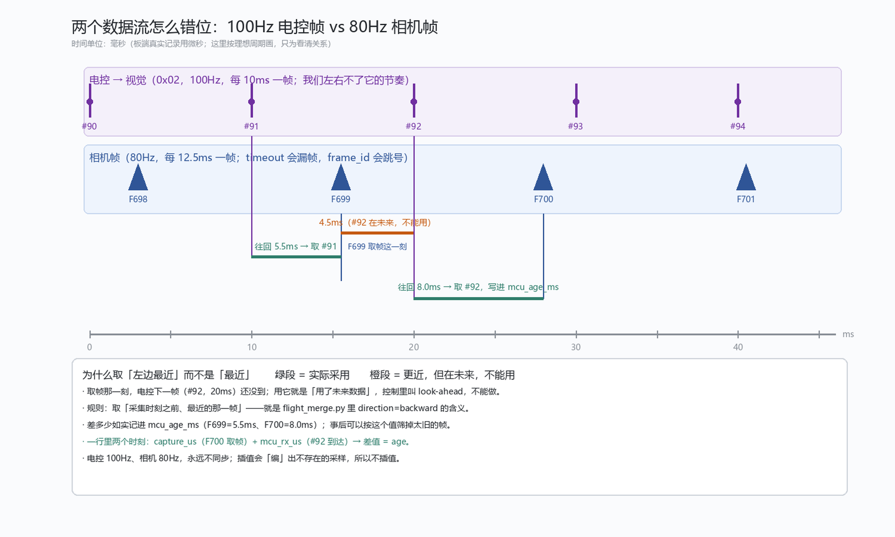
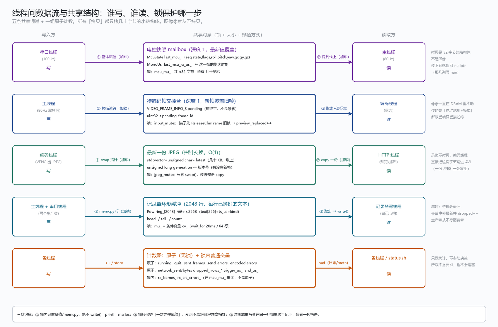

# 飞行数据记录（预录 + 触发）

> 实现：`src/frame_log.{h,cpp}`（记录器）、`src/uart_out.cpp`（接收回调）、`src/camera.cpp`（每帧挂钩）。
> 协议依据：电控《视觉串口通信协议》§4.2（STATE 枚举）与 §4.5（0x02 没有时间戳、不能靠 SEQ 对齐）。
> 分析工具：`tools/flight_merge.py`；无电控联调用的假电控：`tools/fake_mcu_pty.py`。

---

## 1. 为什么是「预录 + 触发」，而不是「收到信号才开文件」

```
真实离手 ──[电控判定耗时?]──> 电控 STATE 变 FLIGHT ──[10ms 发送]──> 视觉收到（最长再 +20ms）
   │                                                                      │
   └──────────── 这段时间的角度/姿态数据如果没记，就永远补不回来 ───────────┘
```

所以行数据**一产生就进环形缓冲**（默认 2048 行，约 11 秒 @180 行/秒），
收到起飞边沿时把缓冲里最近 `log_preroll_ms`（默认 3000 ms）的行整体落盘，
之后继续实时写，落地后再写 `log_postroll_ms`（默认 2000 ms）收尾。

代价：待机时占 ~0.5 MB 内存 + 每帧一次 `snprintf`（实测 <10 µs）。收益：起飞瞬间不丢帧。

## 2. 触发源

| 边沿 | 含义 | 动作 |
|---|---|---|
| `STATE ≠ FLIGHT → FLIGHT` | 起飞 | 建会话，预录落盘，开始实时写 |
| `FLIGHT → 其它`（STOP / STATIC） | 撞击后停止 | 再写 `postroll_ms` 后收尾（`close_reason=landed`） |
| 会话超过 `max_seconds` | 一直没离开 FLIGHT | 强制收尾（`close_reason=max_seconds`） |
| 又出现一次 `→FLIGHT` | 重新起飞 / 误触发 | 先收尾上一段（`retriggered`），再开新会话 |

视觉侧没有 IMU，自己判不了起飞，只能用电控给的 STATE；这是本方案唯一的对外依赖。
若电控没接上/没发 0x02，**trigger 模式会一条都不记**——这是设计取舍，不是故障。
排查看 `health_*.csv`（每秒一行：帧率、电控帧累计数、`mcu_age_ms`）。

## 3. 数据流与线程

```
相机线程（80Hz）──on_frame()──┐                    ┌─ frames.csv  （每帧一行）
                              ├→ 环形缓冲 → 写线程 ─┤
串口线程（100Hz）──on_mcu()───┘   （mutex）         └─ mcu.csv     （每帧一行）
编码线程 ──on_video()───→ video_frames_*.csv（AVI 帧号 ↔ 相机帧号）
相机线程 ──on_health()──→ health_*.csv（1Hz）
```

- 采集线程**不做任何 I/O**：只 `snprintf` 到栈上、`memcpy` 进环形缓冲；
- 写线程每 20 ms 或攒够 64 行 `write()`，每 1 秒 `fdatasync()`（摔机最多丢 1 秒）；
- 缓冲满时：**待机**丢最旧（保住最近 N 行预录）、**会话中**丢最新（保住已落盘的是连续前缀），
  丢行数写进 `meta.txt` 的 `dropped=`；
- 会话中写盘跟不上不会阻塞采集线程。

### 3.1 为什么**录像**不在这个写线程里

录像（AVI）由**编码线程**写，不是记录器写线程。原因有三条，都不是偷懒：

1. **JPEG 只有编码线程有**。硬件 VENC 编出来的那一份 JPEG，被网页、抓图、录像三处复用
   （`latest.swap(jpg)`，O(1) 换指针）。把它挪到记录器线程，就要每帧跨线程拷几十 KB
   （80fps × 4 MB/s 量级），还要引入新的队列和背压——纯属给自己加复杂度。
2. **对齐不靠"同一个线程写"，靠映射表**。编码线程写 AVI 的同时追加一行
   `video_frames_*.csv`（`avi_index, frame_id, capture_us, pts_raw`），
   所以"AVI 第 k 帧 ↔ 相机帧号 ↔ 采集时刻"是可查的；再和 `frames.csv`/`mcu.csv`
   按时间戳 join 就能对上电控数据（`tools/flight_merge.py` 就是干这个的）。
   **写在一起 ≠ 能对齐**，有映射表才能对齐。
3. **两者互不干扰**：AVI 是顺序追加；CSV 的 `fdatasync` 在记录器写线程里。
   实测记录全开时 `encode_fps≈78`、`host_fps≈79`，没有互相拖慢。

> 没有任何"先录像、触发后再把数据回填到帧上"的机制。录像从开机就一直在写
> （`record_enable: true` 时），CSV 只在电控触发时才落盘；两者靠 `frame_id`/时间戳关联。

### 3.2 想让**画面里直接看到电控数据**：开 OSD

CSV 是"事后分析"，如果要在**看录像时**就看到电控当时在干什么，用 `osd_enable: true`：
主线程在把帧交给编码线程**之前**，把 4 行字烧进 Y 平面左上角（见 `src/osd.h`）：

```
F00421 FLIGHT SEQ012 AG008MS
GX  4.00 GY -5.25 GZ  6.75
R   1.0 P  -2.0 Y   3.5
TGT Y 12.3 P  5.7
```

好处：字烧在**像素**里，编码线程丢帧也不会让画面和数据错位（AVI 是定帧率封装，
播放器时间轴本来就会因丢帧漂移）。网页预览、单帧抓图、录像三处同时可见。
代价：每帧多一次点阵绘制 + 一次缓存回写，实测约 60~90 µs（帧预算 12.5 ms 的 0.6%）。

⚠️ 电控 0x02 帧里**没有电机/舵机指令**，只有 `STATE/FLAGS/ROLL/PITCH/YAW/GX/GY/GZ`。
所以 OSD 显示的是**姿态和角速度**（GX/GY/GZ 就是镖体三轴角速度）。
真要显示舵机占空比，必须让电控在他们的帧里加字段（payload 26 字节已满，要扩 `LEN`）。

### 3.3 一行数据的一生（最常被问的问题）



| 步骤 | 谁 | 做了什么 | 这一行里留下什么 |
|---|---|---|---|
| ① | 电控 | 第 93 帧到达（100Hz 定时发，与我们无关） | — |
| ② | 串口线程 | 解析 → **加锁写共享快照** `last_mcu_` | 快照里带 `rx_us = 852982879` |
| ③ | 主线程 | 取到一帧画面（VI 出图） | `capture_us = 852990741` |
| ④ | 主线程 | **立刻**加锁读快照（拿到第 93 帧） | `mcu_rx_us = 852982879`、`mcu_age_ms = 7862 µs` |
| ⑤ | 主线程 | 检测 7.1ms → 拼一行文本 | 22 个视觉列 + 9 个电控列 + 2 个时刻列 |
| ⑥ | 主线程 | `memcpy` 进环形缓冲（微秒级） | 队列里是**已经拼好的字符串** |
| ⑦ | 写线程 | `write()` 到 `frames.csv` | **不再加任何时刻** |

三个容易误解的点，直接说清：

1. **一行只有两个时刻**：画面 `capture_us`、电控数据 `mcu_rx_us`；差值是 `mcu_age_ms`。
   不存在"串口线程的时刻"或"写盘的时刻"混进来。
2. **写盘晚了几毫秒不影响数据**：写线程只搬运文本，不改数值、不加时间戳。
   `mcu_age_ms` 永远是"帧时刻 − 电控接收时刻"。
3. **为什么必须"取帧那一刻立刻读快照"**：等检测（5~20ms）之后再读，期间新到的电控帧
   会被算进这一帧——实测会新 0~9ms（中位 6ms）。这是 11-20 修掉的一个真实 bug。

还剩下的两个"不知道"（只能靠标定/改协议）：曝光时刻比 `capture_us` 早 5~15ms；
电控采样时刻比 `rx_us` 早 3~13ms（传输 2.9ms + 100Hz 周期）。

### 3.4 为什么取"左边最近"而不是"最近"（时间轴）



- 电控 100Hz（每 10ms 一帧）、相机 80Hz（每 12.5ms 一帧），两条流**永远不同步**；
- F699 落在 `#91`(10ms) 与 `#92`(20ms) 之间。此刻 `#92` 还没到——用它就是"用了未来数据"
  （look-ahead），控制上不允许。所以规则是**取采集时刻之前最近的那一帧**，
  这就是 `flight_merge.py` 里 `direction="backward"` 的含义；
- 差多少如实写进 `mcu_age_ms`（F699=5.5ms、F700=8.0ms），事后可以按它筛掉太旧的帧；
- **不插值**：100Hz 数据在帧之间本来就没有采样，插值等于"编"出不存在的值。

### 3.5 缓冲满了丢谁：「待机丢最旧 / 会话丢最新」

这两种状态的目标完全不同，所以丢法也不同（`src/frame_log.cpp:214` 的 `push()`）：

```
【待机（预录中）】目标：留住"触发那一刻之前的最近 N 秒"
  缓冲：[10][11][12][13][14]     ← 满
  新行 15 进来 → 挤掉最旧的 10
  缓冲：[11][12][13][14][15]     ← 永远是最新的那批
  （不计入 dropped —— 这是滚动窗口的正常行为，像行车记录仪）

【会话中（正在落盘）】目标：已写进文件的必须是连续、可解释的序列
  缓冲：[101][102][103][104]     ← 已排队、马上要写进文件
  新行 105 进来（缓冲满）→ 拒绝 105，dropped + 1
  缓冲：[101][102][103][104]     ← 保持不动，等写完腾出位置
```

为什么会话中不能"丢最旧"：那会把**已经排队、马上要落盘**的行悄悄覆盖掉 →
文件里出现说不清的洞，而且洞的位置事后无法定位。丢最新则是**缺口集中在尾部一处**，
`meta.txt` 的 `dropped=N` 就能告诉你"这里丢了 N 行"。

补充三条事实：
- 空闲期的"丢最旧"**不计入**会话的 `dropped`（会话开始时取一次基线，`sess_dropped_`）；
- 缓冲 2048 行：只记帧时 ≈ **25 秒**（80Hz）；开 `log_mcu_stream` 后 ≈ **11 秒**（180Hz）；
- 实测 `dropped=0`：CSV 写入约 18 KB/s，TF 卡顺序写是 MB/s 级，差两个数量级，平时根本触发不到。

### 3.6 串口线程与主线程之间到底怎么"同步"

**先说结论：它们几乎不需要同步。** 这里有两件常被混为一谈的事：

| 说法 | 实际是什么 | 作用 |
|---|---|---|
| "线程同步" | **互斥锁** `mcu_mu_` + 原子变量 `running_` | 防止两个线程同时读写同一块内存产生**撕裂读** |
| "时间戳同步" | 两个线程**共用同一个时钟** `CLOCK_MONOTONIC`，各自给数据打上时刻 | 让"数据是什么时候的"与"什么时候被读走"解耦，**事后按时间配对** |

注意"时间戳同步"这个说法容易误导：**它不是让两个时钟对齐**——两个线程读的是同一个内核时钟，
`rx_us` 和 `capture_us` 天生活在同一条时间轴上，本来就不存在"两个时钟"。

**（1）真正的同步：一把很短的锁**

```cpp
// 串口线程（100Hz）：整份快照一次性覆盖
{ std::lock_guard<std::mutex> g(mcu_mu_);
  last_mcu_ = m; last_mcu_rx_us_ = rx_us; }        // 锁内只做赋值，几十纳秒

// 主线程（80Hz）：整份快照一次性拷走
const McuState* mcu_snapshot(McuState* out) {
  std::lock_guard<std::mutex> g(mcu_mu_);
  if (!has_mcu_) return nullptr;
  *out = last_mcu_;                                // 拷一份，不是给指针
  return out;
}
```

为什么必须是"拷一份"而不是共享指针：否则主线程正在读 `gx` 时，串口线程把 `gz` 改成新帧的值，
这一行就会**半新半旧**——那才是真正的"多个时刻混在一行"。锁 + 整体拷贝就是为了排除这种情况。
锁内不做任何 I/O、不 printf、不分配内存，所以持有时间是纳秒级，不会拖慢 80fps。

**（2）不做排队，只保留"最新一份"（mailbox，深度 1）**

主线程绝不等待串口线程：它每次要的是"**此刻最新的那份**"，没有就返回 `nullptr`。
如果做成队列（攒 100Hz 的每一帧让主线程逐条消费），主线程要么追不上、要么被拖慢——
而它对旧帧根本没用（姿态只用最近一帧）。

**（3）时间戳在这里起什么作用**

因为"最新一份"会被覆盖，主线程读到时无法知道它是几时到的。所以串口线程在写入的**同一把锁里**
顺手记下 `rx_us = monotonic_us()`，主线程把它一起拷走。于是：

```
串口线程：10:03:07.421 收到 #93  → 快照里带 rx_us=...421
主线程  ：10:03:07.429 取帧      → capture_us=...429，age = 429-421 = 8ms
```

**时间戳不参与同步，它参与"事后对账"**：两个线程从不互相等待，但产出的数据能精确配对。

**（4）四个常见误解**

| 误解 | 事实 |
|---|---|
| 主线程会读到写了一半的数据 | 不会：锁内整体覆盖、整体拷贝 |
| 主线程要等电控数据到齐才继续 | 不等：拿当前最新一份，没有就用 `nullptr` |
| 两个线程有各自的时钟，需要对齐 | 没有：`monotonic_us()` 是同一个内核时钟 |
| 加锁会拖慢 80fps | 不会：锁内只赋值，纳秒级；实测记录全开 `78~79 fps` |

**（5）三把锁保护三样不同的东西（图像不参与 `mcu_mu_`）**

| 数据 | 大小 | 锁 | 谁写 | 谁读 |
|---|---|---|---|---|
| 电控快照 `McuState` | ~40 B | `mcu_mu_` | 串口线程 | 主线程 |
| 待编码帧描述符 `VIDEO_FRAME_INFO_S` | ~100 B | `input_mutex` + `pending` | 主线程 | 编码线程 |
| 最新一份 JPEG 指针 | 8 B | `jpeg_mutex` + `generation` | 编码线程 | HTTP 线程 |

图像本身（1280×720 ≈ 1.4 MB）**从来不被拷贝**：它躺在 DRAM 里不动，三个线程传的只是
"描述符"或"指针"。所以"拷一份"永远只指那几十字节的小结构体。

**（6）锁和时间戳各自回答什么（不要混）**

| 问题 | 谁回答 |
|---|---|
| 这一行里的电控字段是不是同一帧的？ | **锁**（整体覆盖 + 整体拷贝，排除撕裂读） |
| 这份电控数据是几时到的、有多旧？ | **时间戳**（`mcu_rx_us`，与 `capture_us` 相减） |
| 画面、电控、视频三者的先后顺序？ | **时间戳**（同一个 `CLOCK_MONOTONIC`，相减有意义） |
| 哪个先发生、哪个后发生？ | 时间戳（锁完全给不出这个信息） |

关键区别：**锁只在"读/写那一瞬"有效**；一旦数据被拷走，锁就再也帮不上忙了。主线程拿着
这份快照还要检测 7ms、组行、排队 20ms，这期间电控又来了好几帧——"你手里这份是 8ms 前的"
这件事，只有时间戳能告诉你。

顺带澄清："同一个时钟" ≠ "同一个时刻"。两个线程读的是同一把尺子，但读的**时刻不同**；
正因为尺子相同，两个读数相减（8ms）才有意义。

**（7）线程间共享结构总览（图）**



五条共享通道，锁、大小、赋值方式各不相同，但都遵守同一条规则：
**锁内只做一次完整赋值或 `memcpy`，绝不跨线程共享指针。**

| 通道 | 赋值方式 | 锁 | 大小 |
|---|---|---|---|
| 电控快照 | 整体赋值 → 整体拷贝到栈 | `mcu_mu_` | ≈32 B |
| 待编码帧 | 拷贝描述符 → 取走并清标志 | `input_mutex` | ≈100 B |
| 最新 JPEG | `swap()` 指针 → 整份 `copy` | `jpeg_mutex` | 8 B 指针 / 几十 KB 数据 |
| 记录器缓冲 | `memcpy` 一行 → 取出 `write()` | `mu_` + `cv_` | ≤256 B × 2048 |
| 计数器 | `++` / `store` → `load` | 原子，无锁 | 8 B |

**（8）计数器都在记什么**

| 计数器 | 类型 | 谁写 | 记的是什么 |
|---|---|---|---|
| `running_` / `quit_` | atomic bool | `start()`/`stop()` | 线程是否继续跑 / 是否要退出 |
| `sent_frames_` / `send_errors_` | atomic ulong | 串口线程 | 成功发出的上行帧数（50Hz）/ 发送失败次数 |
| `rx_frames_` / `rx_crc_errors_` / `rx_other_frames_` | **普通 ulong（锁内）** | 串口线程写、主线程在 `mcu_mu_` 里读 | CRC 通过的电控帧数 / CRC 错帧数 / 其他 CMD 帧数 |
| `encoded` / `errors` | atomic ulong | 编码线程 | 编码成功/失败帧数 |
| `network_sent` / `network_bytes` | atomic ulong | HTTP 线程 | MJPEG 发出的帧数与字节数 |
| `preview_replaced` | atomic ulong | 主线程 | 交接台覆盖旧帧的次数（＝视频丢帧的直接证据） |
| `dropped_` / `rows_frames_` / `rows_mcu_` / `rows_video_` | atomic ulong | 记录器 | 会话中丢的行数 / 三类实际落盘行数 |
| `trigger_us_` / `land_us_` | atomic u64 | 串口线程（边沿检测） | 起飞、落地时刻 |
| `last_mcu_state_` | atomic int | 串口线程 | 上一帧 STATE（判边沿用，避免重复触发） |
| `session_open_flag_` | atomic ulong | 记录器 | 当前是否在会话中（决定缓冲满时丢谁） |

注意 `rx_frames_` 这三个**不是**原子变量：它们由 `mcu_mu_` 保护（`on_mcu_frame` 在锁内
从解析器抄一份出来），因为它们只在收到帧时更新、读的时候也拿锁，用不着额外原子操作。

## 4. 配置（`config.yaml`）

| 键 | 默认 | 说明 |
|---|---|---|
| `log_enable` | `false` | 总开关。`false` 时完全不起线程，行为与之前一致 |
| `log_mode` | `trigger` | `trigger` = 起飞→落地；`continuous` = 开机即连续记录（不需要电控，用来测链路） |
| `log_preroll_ms` | `3000` | 预录窗口。**别设 0**，会丢起飞瞬间 |
| `log_postroll_ms` | `2000` | 落地后继续记多久 |
| `log_max_seconds` | `30` | 单段上限，防写满卡 |
| `log_mcu_stream` | `false` | 是否额外存 100Hz 原始电控流（`mcu.csv`）。**默认关**：`frames.csv` 每行已带电控数据，单文件就是成品表 |
| `log_dir` | 程序目录/`logs` | 绝对路径；留空即用默认 |
| `uart_tx_enable` | `true` | `false` = 只收不发（纯采集）。**注意 `log_mode=trigger` 要求 `uart_enable=true`**，即使不发也要开着串口才能收 |

`start.sh` 对未知键是**直接报错退出**的，所以脚本与二进制必须一起更新；
`sh start.sh --check-config` 会打印 `CONFIG_LOG` 行确认新键被识别。

## 5. 产物

**一次飞行 = `record/` 下的一个文件夹**（视频和数据放在一起）：

```
record/
└── sess_1683s_2531_001/           ← 一次飞行一个文件夹（sess_<开机秒>s_<pid>_<序号>）
    ├── frames.csv                 每帧一行，33 列（视觉 + 电控 9 列）
    ├── meta.txt                   触发/落地时刻、行数、视频区间、配置快照
    ├── video.avi                  本次飞行的视频（触发时开始，落地 + postroll 后收尾）
    ├── video_frames.csv           AVI 第 k 帧 ↔ frame_id（视频和 CSV 的桥梁）
    ├── health.csv                 本段 1Hz 健康行（fps/编码/电控年龄/丢行）
    └── mcu.csv                    （可选）log_mcu_stream=true 时才有
```

**待机时 `record/` 是空的**：没收到起飞边沿就不创建任何文件（连 health 也不写）。
这一点板上实测过——只启动不触发跑 20 秒，`ls record/` 无输出。

四个要点：

1. **录像跟飞行走**：`log_enable: true` + `log_mode: trigger` 时，编码线程在
   `STATE 0→1` 那一刻才开 `video.avi`，落地后（`STATE→STOP` 再记 postroll）收尾。
   所以一次飞行一个视频，和数据同处一个目录，不需要再切。
2. **没开记录时退回连续录像**：`log_enable: false` + `record_enable: true` →
   仍然全程一个 `record/gc4653_<时间戳>_<pid>.avi`（调试用），`video_frames_*.csv` 也在 `record/` 根下。
3. `meta.txt` 里新增四行，用来核对视频数量：
   `video=video.avi`、`video_frames=538`、`video_first_avi=0`、`video_last_avi=537`。
4. **健康行跟着会话走**：`health.csv` 在会话目录里，只记这一段飞行；待机时不产生文件。

### 5.0 板端实测（2026-11-21，假电控触发一次）

```
待机（不触发）20 秒 → record/ 为空

触发后 record/sess_1683s_2531_001/
  frames.csv        782 行 × 33 列
  health.csv        本段 1Hz 健康行
  meta.txt          close_reason=landed  video_frames=538  video_last_avi=537
  video.avi         15.7 MB（1280×720 MJPG）
  video_frames.csv  538 行数据（0..537，与 meta 一致）
```

AVI 结构自检（`python tools/check_avi.py video.avi`，不需要解码器）：
`avih 帧数 = movi 里 00dc 块数 = idx1 条目数 = 588`，RIFF 长度与文件大小一致。


每次起飞一个目录（板子没有 RTC，墙钟是 1970，所以用开机秒数 + pid 命名）：

```
logs/
├── sess_<开机秒>s_<pid>_<序号>/
│   ├── frames.csv    相机每帧一行
│   ├── mcu.csv       电控每帧一行（收到的全部，不抽样）
│   └── meta.txt      触发时刻、配置快照、结束原因、丢行数
├── health_<开机秒>s_<pid>.csv        每秒一行
└── video_frames_<开机秒>s_<pid>.csv  AVI 帧号 → 相机帧号（record_enable=true 时才有行）
```

### 5.1 `frames.csv`（33 列）

| 列 | 含义 |
|---|---|
| `frame_id` | 相机帧号，每取到一帧 +1；**跳号 = 那帧没进记录**（取帧超时） |
| `capture_us` | 取帧时刻（CLOCK_MONOTONIC 微秒）——**不是曝光时刻** |
| `pts_raw` | VI 原始 PTS（板端实测微秒，只记录不换算） |
| `ran_detect` | 1 = 这帧跑了检测；0 = stride 跳过 / 检测关闭（只有时间戳） |
| `detect_us` / `lat_us` | 抽样→结果完成 / 取帧→结果完成 |
| `detected`,`state`,`seq`,`age_ms`,`cand` | 跟踪器输出（state：0 lost / 1 coasting / 2 confirmed） |
| `yaw_deg`,`pitch_deg` | 瞄准点角度（正=右 / 正=上） |
| `vyaw_dps`,`vpitch_dps` | 角速度（前馈用） |
| `dist_m`,`dist_valid` | 单目测距；`dist_valid=0` 时 `dist_m` 无意义 |
| `light_yaw_deg`,`light_pitch_deg` | 绿灯中心角度（未加瞄准点偏移） |
| `gx_px`,`gy_px`,`gr_px` | **原始像素坐标**（标定完善后可用它重算角度） |
| `has_box` | 是否画框 |
| `mcu_state`,`mcu_flags`,`mcu_age_ms` | **取帧那一刻**读到的最近一帧电控状态；`mcu_age_ms` = 该帧采集时刻 − 电控数据接收时刻（毫秒，取整）。<br>⚠️ 必须"取帧后立刻读"：如果等检测（5~20ms）之后再读，期间新到的电控帧会被算进这一帧，实测会新 0~9ms（中位 6ms） |
| `mcu_rx_us` | 这份电控数据的**绝对接收时刻**（单调时钟微秒，0/nan = 无）。<br>有了它，一行里的两个时刻都写明：画面 = `capture_us`，电控数据 = `mcu_rx_us`，差值不用再推算 |
| `mcu_roll`,`mcu_pitch`,`mcu_yaw` | 电控姿态角（度） |
| `mcu_gx`,`mcu_gy`,`mcu_gz` | 电控三轴角速度（度/秒）——**"怎么转"就看这三个** |

> 最后 10 列（`mcu_*`）把电控数据**直接并进了每一帧**：所以默认情况下
> `frames.csv` **一个文件就是"一帧一行"的成品表**，不需要事后再拿 `mcu.csv` 去配对。
> 没收到电控数据时这几个字段写 `nan`，列数恒定，pandas/Excel 都按缺失值处理。
> 代价：每行多约 40 字节（80Hz ≈ 3 KB/s）。
> 需要看两帧之间的完整 100Hz 波形时，再把 `log_mcu_stream` 设为 `true`（会多一个 `mcu.csv`）。

### 5.2 `mcu.csv`（10 列）

`rx_us`（本地接收时刻）、`seq`、`state`（0 STATIC / 1 FLIGHT / 2 STOP）、
`flags`（bit0 IMU_VALID / bit1 BIAS_READY / bit2 ACC_VALID）、
`roll,pitch,yaw`（度）、`gx,gy,gz`（度/秒）。

⚠️ `flags & 0x01 == 0` 时六个 IMU 字段是**电控发的 0.0，不是真实零姿态**（协议 §4.3）；
分析时请先按 `flags` 过滤，别把无效值当成"飞得很平"。

### 5.3 `meta.txt`
触发/落地时刻、`close_reason`、两个流的行数、`dropped`、以及启动时的配置快照
（`build=`、`cfg uart_dev=... `）——**排查"这次数据为什么是这样"先看它**。

## 6. 时间基准与跨流对齐

- 全部时间戳都是 `CLOCK_MONOTONIC` 微秒（板子没有 RTC，墙钟不可信，只写进 `meta.txt` 备查）；
- **不要按 SEQ 对齐**：协议 §4.5 明确 0x02 不带时间戳、不回显视觉序号，且视觉发 50Hz、
  电控发 100Hz、检测 80Hz，三者本来就不是一比一；
- 正确做法是「按时间戳在分析阶段 join」：对每帧取**采集时刻之前最近一帧**电控数据
  （`tools/flight_merge.py` 就是这么做的），并把 `mcu_age_us` 一并给你看。

板端实测（假电控 80Hz、按时间戳反算）：电控数据年龄中位 **7 ms**、p99 **9 ms**、最大 **9 ms**；
若电控真按 100Hz 发，中位约 5 ms。

### 6.1 为什么原始流是分开的，而默认只给你一个 `frames.csv`

**默认产出（`log_mcu_stream: false`）：只有 `frames.csv` 一个数据文件**，每行已经带该帧
时刻的电控 7 个字段 —— 直接就是"一帧一行"的成品表，不需要事后配对。

原始的三条流仍然存在，但按需开启：

| 流 | 生产者 | 速率 | 自己的丢失模式 | 默认是否落盘 |
|---|---|---|---|---|
| `frames.csv` | 主线程 | 80Hz（受 `detect_stride` 影响） | 取帧超时会漏帧（`frame_id` 跳号可见） | ✅ 总是 |
| `mcu.csv` | 串口线程 | 100Hz（电控定死的） | CRC 错帧丢弃、SEQ 可能跳号 | 仅 `log_mcu_stream: true` |
| AVI 视频 | 编码线程 | ≤80Hz（编码跟不上就整帧丢） | 与帧流不是一比一，所以需要 `video_frames.csv` 映射 | 仅 `record_enable: true` |

为什么板端不把三者硬拼成一个文件（这条没变）：

1. **三条流各有自己的时钟**：相机是"取到才有一帧"，电控是"定时发"，编码是"编完才写"。
   硬塞进一行就必须选一个主导时钟、把另外两个重采样，等于丢信息；
2. **协议没给对齐的钥匙**：0x02 帧没有时间戳、也不回显我们的 SEQ（协议 §4.5），
   AVI 又是定帧率封装——唯一可靠的公共量只有**视觉板本地的单调时钟**。
   所以每条流各带本地时间戳，是唯一可行的做法；
3. **失败隔离**：CSV 丢行会计数（`dropped`）、坏 CRC 不覆盖快照、视频丢帧只影响画面。
4. **解释权放到离线**：想换合并策略（最近邻 / 插值 / 窗口均值）改脚本就行，不用重新飞一次。

代价：`frames.csv` 约 15 KB/s（含电控列）；再开 `mcu.csv` 多 ~6 KB/s；一场 30 秒 < 1 MB。

## 7. 板端实测（2026-11-19，`/code/fly_LicheeRV`）

| 场景 | 结果 |
|---|---|
| 基线（uart/log 全关，新旧二进制同温对比） | 旧 79.80 fps / 新 79.71 fps，检测 5.36 / 5.46 ms → **无回归** |
| 记录全开（trigger + 100Hz 假电控 + 80Hz 帧） | **78.4–79.0 fps**，`dropped=0`，温度 66.8→71.7 °C |
| 空闲（预录中，未触发）CPU | 1 秒内 **0.001 s**（写线程不空转，见下） |
| 触发 → 落盘 | 会话目录含 **3.0 s 预录**（820 帧 / 841 电控行）、`close_reason=landed` |

**踩到并修掉的坑**：第一版写线程只在"缓冲空"时才睡，而预录期缓冲是故意不抽干的，
于是写线程 100% 空转；单核板上直接把采样从 5 ms 拖到 10 ms、**80 fps 掉到 52 fps**。
修法：空闲也必须 `wait_for(20ms)`；`tests/frame_log_test.cpp` 增加「空闲 1 秒 CPU < 0.30s」
回归断言（当前 0.001s）。

## 8. 飞行前检查清单

```sh
# 1) 配置文件（板端 /code/fly_LicheeRV/config.yaml）
uart_enable: true          # 必须开（trigger 靠电控 STATE 边沿）
uart_device: /dev/ttyS1    # ← 接线确认过的那个 UART
uart_tx_enable: true       # 要发角度给电控就 true；纯采集可 false
log_enable: true
log_mode: trigger

# 2) 校验（新建键写错会在这里报错，不会带病起飞）
sh start.sh --check-config | grep CONFIG_LOG

# 3) 起飞前确认链路真的通（终端里应每 10Hz 刷一行）
tail -f /tmp/fly_licheerv_capture.log | grep MCU
#   看到 state=STATIC 说明电控在发；一条都没有 = 线没接/波特率不对/电控没使能

# 4) 飞完取数据
scp -r root@10.133.124.1:/code/fly_LicheeRV/logs ./logs
```

## 9. 分析：`tools/flight_merge.py`

```sh
# 合成「一帧一行」的表 + 打印摘要（纯标准库，板子上也能跑）
python tools/flight_merge.py record/sess_001234s_900_001

# 另存一份带折线图的 Excel（需要 pandas + openpyxl）
python tools/flight_merge.py record/sess_001234s_900_001 --xlsx merged.xlsx
```

样例输出（2026-11-19 板上实测会话）：

```
会话 sess_855s_3104_001
  时长       10.49 s，帧 820 行，平均 78.19 fps
  电控帧     841 行（80.2 帧/秒）
  STATE      -0.008s→STATIC  +2.992s→FLIGHT  +8.992s→STOP
  飞行窗口   2.992 s → 8.992 s（6.000s）
  检出帧     0 / 820（0.0%）
  电控数据年龄：中位 7.8 ms，p99 9.0 ms（帧采集时刻距最近电控帧）
已写出 .../merged.csv（820 行 × 35 列）
```

`merged.csv` = `frames.csv` 的全部列 + `t_s`（相对第一帧的秒数）+ `mcu_*` 列 + `mcu_age_us`。
直接丢进 Excel / Origin / pandas 就能画「角度、角速度、距离 vs 时间」。

## 10. 没有电控时怎么验证整条链路

`tools/fake_mcu_pty.py` 会造一个 pty 并按 100Hz 发 CMD=0x02，STATE 按
15s 静止 → 6s 飞行 → 4s 停止 变化：

```sh
# 板端
python3 /tmp/fake_mcu_pty.py 60 &          # 会打印 pty 路径，并写进 /tmp/mcu_pty_path
# 把 uart_device 改成那个 /dev/pts/N，然后正常 sh start.sh 45
# 期望：日志里出现 LOG_SESSION_OPEN / LOG_SESSION_CLOSE，logs/ 下多出一个 sess_* 目录
```

## 11. 已知限制

1. **没有 RTC**：文件名用开机秒数，跨机对比要靠 `meta.txt` 里的 `wall=`（可能是 1970）。
2. **触发依赖电控**：电控不发/线没接 → trigger 模式什么都不记（`health_*.csv` 能看出原因）。
3. **`STATE` 语义由电控定义**：`STATIC→FLIGHT` 的判定延迟、装填时会不会误触发、落地后会不会回 STATIC，
   都是他们要确认的事；误触发只会多一个会话，不会污染别的会话。
4. **`video_frames_*.csv` 只有开录像才有行**（`record_enable: true`）；AVI 是定帧率封装，
   编码线程会整帧丢，所以"It's 视频第 k 帧" 必须靠这张表映射回 `frame_id`。
5. **测距/角度本身带标定误差**：`cam_fx/fy/cx/cy` 与 `target_diameter_m` 目前是估算值，
   所以 `gx_px/gy_px` 一定要留着，标定完能重算。
6. 记录器只记录**跑过检测的帧**的完整结果；没跑检测的帧只有时间戳（`ran_detect=0`）。
