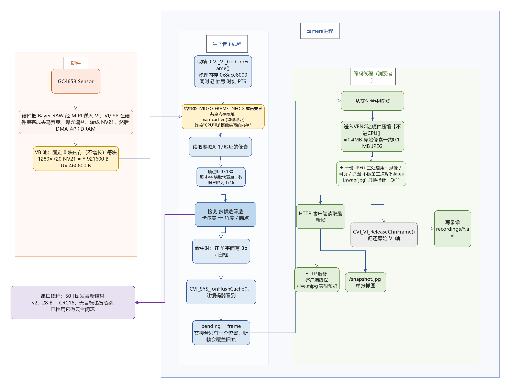

# 飞镖镖体视觉系统 · 中期技术审核报告

| 项 | 内容 |
|---|---|
| 项目名称 | RoboMaster 飞镖镖体视觉系统（LicheeRV Nano 平台） |
| 审核阶段 | 中期技术审核 |
| 文档版本 | v1.1 |
| 编写日期 | 2026-11-16 |
| 参赛队伍 | （待填） |
| 代码基线 | `feat/green-detect` @ `ddfdc44`；板端二进制 md5 `cde20c8c…`（476,136 B） |

---

## 1 项目概述

### 1.1 任务定义

飞镖镖体视觉系统安装于制导镖体，任务是在飞行/制导阶段完成：

1. 识别目标区域内的**绿色圆形引导灯**；
2. 由图像坐标解算目标相对相机光轴的**水平角、俯仰角**及角速度；
3. 按固定频率通过串口把结果发送给电控，由电控完成云台闭环与弹道补偿；
4. 最终命中**引导灯上方的装甲板**（当前以"灯中心向上偏移固定比例"的方式逼近该瞄点）。

系统只负责"看"和"算"，不参与姿态控制与击发决策。

### 1.2 目标体系

**总体目标**：在 LicheeRV Nano 平台上做出一套能在赛场稳定运行的镖体制导视觉——单帧处理不超过 8 ms、输出可闭环的角度与角速度、通过串口与电控稳定通信，并在命中前把瞄点稳定收敛到装甲板中心。

**中期目标（本次审核节点）**：

1. 打通"传感器 → 检测 → 跟踪 → 角度 → 串口/网页"的完整链路，并能在板端连续运行；
2. 检测与跟踪在 80 fps 下不成为瓶颈（单帧 ≤ 8 ms）；
3. 串口协议定型，可被电控独立解析（含校验、心跳、无目标状态）；
4. 角度输出具备可评估的精度（完成本机标定与已知角度验证）；
5. 形成可复现的构建、部署与自检流程（一条命令编译、一条命令部署、离线自检 181 项）。

**终期目标（赛前）**：

1. 真实目标在比赛距离与光照下稳定检出（给出"距离—检出率"曲线）；
2. 瞄点精度经打靶验证，弹着点偏差可解释、可补偿；
3. 满负荷连续运行 30 分钟不降级、不超温停机；
4. 与电控完成闭环联调，具备掉线与异常恢复能力。

**不在本期范围**：镖体姿态控制、击发决策、弹道解算（均由电控负责）。

### 1.3 中期指标与达成情况

| 指标 | 目标 | 当前 | 状态 |
|---|---|---|---|
| 图像采集 | 1280×720，稳定 80 fps | **78~82 fps**，无重复时间戳/取帧超时 | 达成 |
| 单帧检测耗时 | ≤ 8 ms（帧预算 12.5 ms） | **5.4~5.9 ms**（抽样 4.9~5.3 + 跟踪 0.4~0.6） | 达成 |
| 角度输出 | 连续、可闭环；中心区误差 ≤ 0.5° | 中心区理论 ≈0.2~0.3°；**尚未本机标定与实测** | 部分达成 |
| 串口输出 | 50 Hz 固定频率、带校验、无目标也发送 | 已实现（ASCII v1 + 二进制 v2，CRC16） | 达成（待联调） |
| 网页预览 | 实时 MJPEG + 单帧抓图 | 已实现，HTTP 200 | 达成 |
| 长时间运行 | 连续 30 分钟不掉帧、不超温停机 | **未验证**；满负荷 105 s 升温 2.1°C 且未收敛 | 未达成 |
| 真实目标检出 | 比赛距离内稳定检出 | **未验证**（当前场景无真实目标） | 未达成 |

### 1.4 技术方向：对齐同平台的成熟方案

本项目所用硬件（SG2002 + GC4653、1280×720、80 fps）与哈工大威海 HERO 战队开源的镖体视觉 `dart_vision_26`（MIT 许可，GitHub：`Ruakker/dart_vision_26`，分支 `dart_body`）完全一致。该方案已在同一块板子上跑通并用于比赛，因此我们把它作为**技术方向的基准**：链路形态、接口设计、工程做法向它对齐，再结合我们的靶标、场地与电控接口做适配。

| 环节 | HERO `dart_vision_26` | 本项目当前 | 后续方向 |
|---|---|---|---|
| 检测 | NPU（YOLOv8 单类"引导灯"）+ 长宽比/绿色复筛 | 纯传统视觉（YUV 阈值 + 形态学 + 连通域 + 形状过滤） | 传统链路保留为兜底；抗干扰不足时增加 NPU 单类初筛 |
| 跟踪 | 角度域卡尔曼 + 单目标跟踪 | 多候选加权 + 角度域卡尔曼 + confirmed/coast/lost | 已对齐，后续用真实目标调参 |
| 输出 | 串口 115200，`0xAA` 帧头 + CRC8 | 串口 115200，二进制 28 B（CRC16 覆盖整帧）+ ASCII 调试版 | 与电控确认后固定 v2 |
| 瞄点 | 灯中心上移 `1.5 × bbox 高`，等价于按灯直径缩放 | 同比例法（`k = 1.5`），偏移量加在卡尔曼测量点上 | 量取靶标几何后重算 k；长期改为装甲板识别 |
| 标定 | 棋盘格 rms 0.27 px；代码不做畸变校正 | 沿用同款模组内参，尚未本机复标 | 本机标定，并评估是否需要畸变校正 |
| 运维 | 板端 RTSP 调参 + 内录复盘 | 网页 MJPEG + 单帧抓图 + 5 秒统计日志 + 开机自启 | 补长时运行与断电恢复演练 |

**为什么以它为准**：同一颗芯片、同一颗传感器、同样的 80 fps 约束，它验证了"这个算力下什么做法可行"。沿用它的接口形态（角度 + 角速度 + 距离 + 心跳）可以降低电控侧改动，也便于出问题时逐项对照排查。

**我们的增量**：把"检测 → 跟踪 → 串口"做成了可离线自检的工程链路（181 项检查），并对帧时间戳、串口发送年龄、tty 守护与断线重开等细节做了加固——这些是原开源方案没有覆盖、但赛场上容易出问题的地方。

**演进路线**：传统视觉（当前，已跑通 80 fps）→ 增加 NPU 单类初筛（对齐 HERO，提升抗干扰）→ 装甲板识别（替代比例偏移，提升瞄点精度）。

---

## 2 技术方案

### 2.1 硬件平台

| 项 | 选型与理由 |
|---|---|
| 主控 | LicheeRV Nano-B（SG2002，RISC-V C906 1 GHz + 1 TOPS INT8 NPU）——体积小、功耗低、原生支持 GC4653 |
| 相机 | GC4653，1280×720；使用项目自带用户态驱动（720P 寄存器表 + 36 MHz 相机 PLL），实测 78~82 fps |
| 编码 | 芯片内置硬件 JPEG 编码器，CPU 零占用，用于网页预览与赛后可回放录制 |
| 接口 | UART（3.3 V TTL，115200 8N1）对接电控；USB/Wi-Fi 提供网页预览与调试通道 |

### 2.2 软件架构

单进程、五线程，避免跨进程拷贝带来的延迟与不确定性：

```
┌─ 主线程（80 Hz）─────────────────────────────────────────┐
│ VI 取帧 → 4× 抽样（320×180 网格）→ 绿色检测 → 多候选筛选 │
│        → 卡尔曼跟踪 → 角度/角速度 → 发布最新结果        │
│        → 画检测框写回 Y 平面 → 交给编码线程             │
└─────────────────────────────────────────────────────────┘
   ├─ 编码线程：硬件 JPEG → 网页 MJPEG / 单帧抓图 / 可选录像
   ├─ HTTP 线程：监听 8081，多客户端互不阻塞
   ├─ 串口发送线程：50 Hz 固定节拍，只发"最新快照"
   └─ 串口接收线程：解析电控下行帧（预留，当前未接线）
```



设计要点：

- **只保留最新结果**：不建立结果队列，主线程发布即覆盖，避免旧数据累积延迟；
- **检测内联在取帧线程**：5.4 ms 可放入 12.5 ms 帧预算，拆线程只会增加锁与切换开销；
- **固定 50 Hz 心跳**：无目标也发送，电控可据此判断"视觉在线但没看到"与"视觉掉线"；
- **时间戳贯穿**：取帧时刻、帧号、检测耗时、串口发送年龄均落日志，便于定位延迟来源（实测"取帧→开始写串口"平均 11.5 ms）。

### 2.3 关键算法

**2.3.1 目标检测**（纯传统视觉，无 NPU 依赖）

- 在 320×180 网格上做 YUV 判据：亮度 Y > 阈值、色度 U/V 同时低于 128（绿色方向）、饱和度达标；
- 块内 n×n 取最大值（发光目标是亮斑，单点抽样易漏检）；
- 3×3 形态学开运算去噪 → 8 连通域 → 形状过滤（面积、填充率、长宽比、等效半径）；
- 输出多个候选及质量分（亮度 + 饱和度）。

**2.3.2 多候选筛选与跟踪**

- 评分 = 质量权重 × 质量分 +（1 − 权重）× 离预测位置远近，选出唯一目标；
- 角度域 2 状态卡尔曼（角度、角速度），匀速模型，dt 使用**相邻帧采集时刻差**（避免把抽样/检测/日志抖动计入）；
- 三状态机：`confirmed`（连续命中 ≥5 帧，可闭环）/ `coasting`（短时跟丢，用预测维持）/ `lost`（停止输出）。

**2.3.3 角度解算与瞄点**

- 针孔模型：`yaw = atan((px − cx)/fx) − 光轴补偿`，`pitch = −atan((py − cy)/fy) − 光轴补偿`；
- 方向约定：yaw 正 = 目标在光轴右侧；pitch 正 = 目标在光轴上方；装配差异由翻转开关适配；
- **瞄准点**：实际命中目标是引导灯上方的装甲板，采用"灯中心向上偏移 `k × 灯直径`"的比例法（参考公开开源实现，MIT 许可，k=1.5）。比例法的优点是与距离无关、自动按检测框尺寸缩放；偏移量放在卡尔曼的测量点上，滤波器跟踪的即为瞄点。

**2.3.4 单目测距**

`z = f × D / 像素直径`（D 为灯实际直径），再按角度修正为斜距；无有效几何时输出 −1 表示无效。

### 2.4 对外接口（串口协议摘要）

已实现两版，可通过配置切换：

| 版本 | 格式 | 说明 |
|---|---|---|
| v1（ASCII） | `$GT,det,yaw,pitch,vyaw,vpitch,dist,age,seq,state*CS\r\n` | 便于串口助手直接查看，用于早期联调 |
| **v2（二进制，推荐）** | `A5 5A \| LEN \| SEQ \| CMD \| 数据(21 B) \| CRC16`，整帧 **28 B** | 50 Hz 下仅占 115200 带宽的 12%；CRC16 覆盖整帧；字段：`detected` + `yaw/pitch/vyaw/vpitch/dist`(f32) |

- 50 Hz 固定发送，无目标时 `detected=0`、角度清零、`dist=−1`（心跳帧）；
- 协议文档与测试向量已提供给电控，含可独立验证的十六进制样本与 CRC 参考实现；
- 支持下行帧解析（模式/急停等），但需硬件补接 RX 线后才能启用。

### 2.5 可靠性与运维设计

| 机制 | 说明 |
|---|---|
| 配置校验 | 启动前校验 YAML 全部参数，非法值直接拒绝启动，避免"静默用错值" |
| 相机时钟 | 启动时切换到 36 MHz 并校验，退出时恢复原值（`0x00200001`），避免残留状态 |
| 相机锁 | 单实例锁，防止两个进程抢同一相机 |
| 温度保护 | ≥70°C 拒绝启动，≥74.5°C 主动停机（当前策略，见 §5） |
| 串口守护 | 周期性检查 tty 参数，被外部改回非 raw 时自动恢复；连续写失败自动重开设备 |
| 开机自启 | `/etc/init.d/S99flycamera`，等无线获取 IP 后启动，读取独立配置（常驻、不自动录像） |
| 诊断日志 | 每 5 秒输出采集/检测/编码/串口/温度相关指标；`GREEN_TARGET` 限频 10 Hz |

---

## 3 进度与完成情况

### 3.1 里程碑对照

| 阶段 | 内容 | 状态 |
|---|---|---|
| M1 取流链路 | 720P/80 fps 稳定采集、网页预览、录像 | 已完成 |
| M2 目标检测 | 绿色圆灯检测、多候选、形状过滤 | 已完成 |
| M3 跟踪与角度 | 卡尔曼、状态机、角度/角速度、单目测距 | 已完成 |
| M4 串口输出 | ASCII + 二进制协议、心跳、自检工具 | 已完成（待电控联调） |
| M5 瞄准点 | 装甲板瞄点比例偏移 | 已完成（系数待实测标定） |
| M6 系统集成 | 开机自启、温度保护、日志、镜像备份 | 已完成（自启可靠性待加固） |
| M7 标定与实测 | 本机内参标定、角度验证、真实目标检出率 | **未完成（下一步重点）** |
| M8 长时稳定 | 30 分钟连续运行、热与内存曲线 | **未完成** |

### 3.2 已完成的功能

- 1280×720 @ 78~82 fps 采集与硬件 JPEG 编码；
- 绿色圆灯检测（YUV 判据 + 形态学 + 连通域 + 形状过滤）；
- 多目标加权筛选、角度域卡尔曼、confirmed/coast/lost 状态机；
- 角度/角速度/单目距离输出，含光轴补偿与瞄准点偏移；
- 串口 v1/v2 协议、50 Hz 心跳、CRC16 校验、tty 守护与断线重开；
- 网页实时预览 + 单帧抓图 + 检测框叠加；
- 开机自启、参数校验、时钟与相机锁保护、诊断日志；
- 完整的离线自检工具链（算法、协议组帧/解帧、pty 字节级、收发时序），共 **181 项检查**。

### 3.3 进行中 / 未开始

- 本机相机标定与角度实测（进行中，工具已就绪）；
- 真实目标检出率与外场测试（未开始，需目标与环境）；
- 装甲板瞄点系数的实测标定（未开始，需靶标几何数据）；
- 30 分钟长时稳定与散热验证（未开始）；
- 与电控的联调（等待接口确认与硬件接线）。

---

## 4 验证与测试

### 4.1 性能实测（板端，1280×720）

| 指标 | 实测 | 条件 |
|---|---|---|
| 采集帧率 | 78.1~82.5 fps | 稳态约 78~80；`duplicate_pts=0`、`timeouts=0` |
| 检测耗时 | 5.36~5.86 ms | 抽样 4.9~5.3 ms + 跟踪 0.44~0.57 ms |
| 编码帧率 | ≈79 fps | 硬件 JPEG，`encode_errors=0` |
| 取帧→串口发送 | 平均 11.5 ms，最大 16~28 ms | 50 Hz 发送；含处理 5.1 ms |
| 网页响应 | HTTP 200，单帧约 27 KB | 单客户端限速约 20 fps |
| 开机到出画面 | 15~20 s | 含无线获取 IP 的等待 |
| 内存占用 | 可用约 81 MB | 未做长时曲线 |

### 4.2 功能自检（主机侧，可复现）

| 测试集 | 覆盖内容 | 结果 |
|---|---|---|
| 算法与时间戳 | 角度换算、卡尔曼、状态机、多目标、瞄点偏移、时间戳/年龄 | **63/63** |
| 协议组帧/解帧 | 帧格式、CRC16、边界值、下行命令 | **42 项全过** |
| 字节级端到端 | 用 pty 驱动生产代码，逐字节比对（含断线行为） | **37/37** |
| 二进制收发时序 | 50 Hz 节拍、重复帧、缓冲满 | **23/23** |
| 下行解析 | 粘包/半包/校验错/超时回落 | **16/16** |

所有测试 0 编译警告；交叉编译产物与板端运行版本一致（md5 校验通过）。

### 4.3 热与稳定性（当前数据，未达标）

| 时间 | 温度 | 帧率 |
|---|---|---|
| 满负荷 0 s | 66.8°C | 78.4 fps |
| 45 s | 67.8°C | 78.5 fps |
| 105 s | 68.9°C | 78.9 fps |

温度持续上升且未收敛；系统策略为 ≥70°C 拒绝启动、≥74.5°C 主动停机。**该指标尚未达到"连续 30 分钟"的中期要求**，为本阶段首要风险。

### 4.4 角度精度评估

当前内参取自同款模组的标定结果（fx≈1023.2、fy≈1022.2、rms 0.27 px），**尚未在本机复标**；代码按针孔模型解算，未做畸变校正。按该内参计算的误差预算：

| 误差源 | 量级 | 是否已被标定覆盖 |
|---|---|---|
| 主点偏差 | 1 px → 0.056°（10 px → 0.56°） | 是（需本机标定） |
| 焦距偏差 | 5% → 10° 处 0.49° | 是（需本机标定） |
| 镜头畸变（未校正） | 中心 0；±200 px 0.19°；±356 px 1.05°；±556 px 3.8°；边缘 5.6° | **否**（需增加畸变校正） |
| 检测量化（4× 抽样） | 1 网格 = 0.22°（质心为亚像素，实际更小） | 否 |
| 瞄点比例系数误差 | 10% → 3 m 处 0.16° | 否（需靶标几何实测） |
| 传输与处理延迟 | 11.5 ms → 50°/s 时 0.57° | 部分（可用角速度前馈补偿） |

结论：**画面中心区（水平 ±11°、垂直 ±6°）理论误差约 0.3°，满足闭环需求；画面边缘误差可达数度，需畸变校正或约束目标保持在中心区。**上述数值为计算值，本机实测尚未开展。

---

## 5 当前问题与风险

### 5.1 问题清单

| 编号 | 问题 | 证据 | 影响 | 措施 | 优先级 |
|---|---|---|---|---|---|
| P1 | **散热不足** | 满负荷 105 s 升 2.1°C 未收敛；策略为 70°C 拒启、74.5°C 停机 | 比赛中途断流，重启也会被拒 | 物理散热（散热片+风扇）；软件改为"超温降帧率"而非停机；温度入日志 | 高 |
| P2 | **未本机标定、未校畸变** | 内参为同款模组值；代码不含畸变模型 | 目标偏离中心时角度误差数度 | 棋盘格本机标定（工具已就绪）；必要时增加畸变校正 | 高 |
| P3 | **真实目标未验证** | 板端日志 `hits=0`；阈值仅按单帧调节 | 有效射程、检出率、抗干扰均未知 | 2/3/5 m 多光照实测，输出"距离-检出率"曲线并调参 | 高 |
| P4 | **装甲板瞄点系数未实测** | `k=1.5` 为参考值；灯直径与靶标几何未测量 | 瞄点偏差随距离放大 | 量取靶标几何后重算系数；打靶纸验证并区分常数/比例偏差 | 高 |
| P5 | 开机自启可靠性 | 一次冷启动无启动记录（脚本手动执行正常） | 无人值守时可能无画面 | 启动日志加时间戳、失败重试、8081 健康检查 | 中 |
| P6 | 电控接口未联调 | 协议已交付，`uart_enable=false`，未接真实电控 | 无法验证端到端闭环 | 与电控确认协议；接 USB-TTL 抓包；补 RX 线验证下行 | 中 |
| P7 | 长时稳定未验证 | 最长连续运行约 225 s | 未知的内存增长/帧率衰减 | 30 分钟连续运行，记录温度/帧率/内存曲线 | 中 |
| P8 | 系统时间无 RTC | 开机后系统时间为 1970 | 日志时间戳不可用于事后对齐 | 开机校时（NTP 或手动） | 低 |
| P9 | 弱光画面偏暗 | 手动曝光 3000 µs、增益 1.0×，实测亮度极低 | 暗环境下检出率下降 | 按现场光照调整曝光/增益或改自动曝光 | 低 |

### 5.2 风险登记

| 风险 | 可能性 | 影响 | 应对 |
|---|---|---|---|
| 高温导致比赛中停机 | 高 | 高 | 散热改造 + 降频策略（本阶段完成） |
| 靶标几何与假设不符，瞄点系统性偏移 | 中 | 高 | 打靶实测标定；必要时改用装甲板识别 |
| 真实目标检出率不足（小目标/逆光） | 中 | 高 | 提高采样密度或引入 NPU 初筛（有帧率代价，需实测权衡） |
| 电控接口变更导致返工 | 中 | 中 | 协议已文档化并附测试向量；版本化，变更走兼容升级 |
| 存储卡/镜像损坏导致停摆 | 中 | 中 | 已建立镜像与部署包归档，恢复时间 <30 分钟 |

---

## 6 后续计划

### 6.1 近期（联调前，约 2 周）

| 工作 | 交付物 | 验收标准 |
|---|---|---|
| 散热改造 | 散热结构 + 超温降频策略 | 满负荷 30 分钟温度 <72°C、帧率 ≥40 fps、不停机 |
| 本机标定 | 新的内参写入配置 | 重投影 rms < 0.5 px |
| 角度实测 | 已知角度对比报告 | 中心区误差 <0.5° |
| 真实目标测试 | 距离-检出率曲线 | 比赛距离内连续 10 s 不漏检 |
| 自启加固 | 启动日志/重试/健康检查 | 连续 5 次冷启动均自动出画面 |

### 6.2 中期（比赛前，约 4 周）

| 工作 | 说明 |
|---|---|
| 电控联调 | 打开串口，抓包验证 28 B 协议；打靶纸调光轴补偿与瞄点系数 |
| 装甲板识别（可选升级） | 识别装甲板两条灯条（颜色与绿灯可分）或用 NPU 训练专用类，替代比例偏移 |
| 畸变校正（条件性） | 若比赛允许目标偏离画面中心 >20°，加入畸变反解 |
| 长时与恢复演练 | 30 分钟长跑、断电重启、镜像恢复演练 |

### 6.3 需要评审方确认或支持的事项

1. **靶标几何**：绿色引导灯的直径、装甲板中心相对灯中心的垂直/水平距离（用于瞄点系数计算）；
2. **场地照度范围**：用于确定曝光/增益与检测阈值的整定区间；
3. **电控接口**：确认采用二进制 v2（28 B、50 Hz）或 ASCII v1，以及是否需要下行通道（需增加 RX 线）；
4. **散热结构建议**：镖体内部可用空间与风道，是否允许加装微型风扇。

---

## 7 结论

1. **核心链路已完成并验证**：80 fps 采集、5.4~5.9 ms 检测、跟踪与角度输出、串口（ASCII/二进制）与网页预览，均通过 181 项离线自检；
2. **中期指标中"实时性、功能完整性"已达成**；"长时间稳定"与"真实目标验证"未达成，是本阶段主要缺口；
3. **下一步优先级明确**：散热 → 标定与角度实测 → 真实目标测试 → 装甲板瞄点标定 → 电控联调；
4. 当前技术路线（纯传统视觉 + 卡尔曼 + 单目角度）在镖体算力与实时性约束下是合理选择；若后续装甲板识别需求明确，可在 NPU 上增加一级初筛，已有帧率余量评估方法。

---

## 附录 A 关键参数（当前配置）

| 参数 | 值 | 说明 |
|---|---|---|
| 分辨率 / 帧率 | 1280×720 / 目标 80 fps | 传感器 720P 模式 + 36 MHz 相机 PLL |
| 检测抽样 | 4×（320×180 网格），块内 1×1 | 保 80 fps 的关键参数 |
| 检测阈值 | Y>100、U/V<124、饱和度≥30 | 可按现场光照调整 |
| 卡尔曼 | 过程噪声 50、测量噪声 0.001 | 角度域 2 状态 |
| 状态机 | 确认 5 帧、丢失 10 帧 | confirmed / coasting / lost |
| 瞄点系数 | 1.5 × 灯直径 | 参考值，待靶标几何实测 |
| 相机内参 | fx 1023.2 / fy 1022.2 / cx 643.8 / cy 382.8 | 同款模组标定值，待本机复标 |
| 串口 | 115200 8N1，50 Hz，二进制 28 B | CRC16 覆盖整帧 |
| 温度策略 | ≥70°C 拒启，≥74.5°C 停机 | 计划改为降帧率 |

## 附录 B 术语

| 术语 | 含义 |
|---|---|
| VI / VENC | 视频输入（取帧）/ 视频编码（硬件 JPEG） |
| confirmed / coasting / lost | 连续命中 / 短时预测 / 丢失 |
| 瞄点 | 视觉最终瞄准的位置（装甲板），非引导灯中心 |
| 心跳帧 | 无目标时仍按 50 Hz 发送的 `detected=0` 帧 |

## 附录 C 修订记录

| 版本 | 日期 | 修订内容 |
|---|---|---|
| v1.0 | 2026-11-16 | 中期技术审核初版：方案、进度、验证数据、问题与后续计划 |
| v1.1 | 2026-11-16 | 补充目标体系（总体/中期/终期）与技术方向（对齐 HERO `dart_vision_26`）；新增"一帧的旅程"数据流图（图 2-1，整页横向） |
